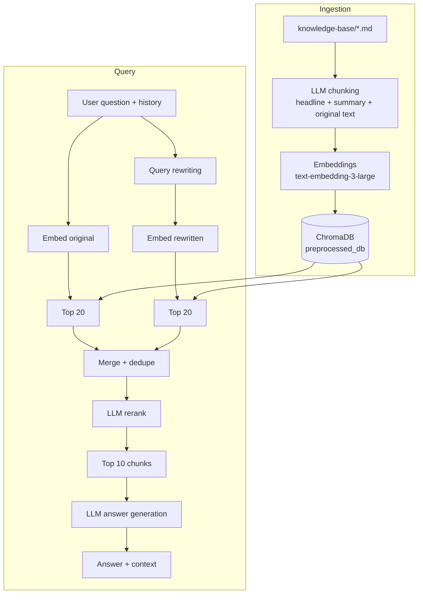

# RAG Assistant

Retrieval-Augmented Generation (RAG) pipeline for question answering over a company knowledge base (not real company Insurellm). It combines LLM-based chunking, query rewriting, dual-query vector retrieval, LLM reranking, and a Gradio chat UI. A separate dashboard measures retrieval and answer quality.

## Features

- **LLM-based chunking.** Each document is split by an LLM into overlapping chunks. Every chunk gets a headline, a summary, and the original text, which are embedded together.
- **Query rewriting.** The user question and chat history are condensed into a short, specific search query.
- **Dual retrieval.** Both the original and the rewritten question are embedded and searched. Results are merged and deduplicated.
- **LLM reranking.** Merged candidates are reordered by relevance with a structured-output reranker.
- **Grounded answering.** The top chunks are injected into the system prompt. The model is instructed to say so when it does not know.
- **Chat UI** with a side panel that shows the retrieved context and its sources.
- **Evaluation dashboard** for retrieval metrics (MRR, nDCG, keyword coverage) and answer metrics (accuracy, completeness, relevance).

## Architecture



## Project structure

```
.
├── app.py                  # Gradio chat UI
├── evaluator.py            # Gradio evaluation dashboard
├── implementation/
│   ├── ingest.py           # chunking + embedding + vector store creation
│   └── answer.py           # retrieval, reranking, answer generation
├── evaluation/
│   └── eval.py             # evaluation logic and test set loaders
├── pro_implementation/     # alternative implementation (see its own files)
├── knowledge-base/         # source documents (markdown), grouped by type
│   └── <doc_type>/**/*.md
├── preprocessed_db/        # ChromaDB storage created by implementation/ingest.py (generated)
├── vector_db/              # vector store directory (not used by implementation/)
└── .env                    # API keys
```

## Requirements

- Python 3.10+
- OpenAI API key (embeddings and ingestion model)
- Groq API key (answer generation, query rewriting, reranking)

Dependencies:

```bash
pip install gradio python-dotenv openai chromadb litellm pydantic tenacity tqdm pandas
```

## Configuration

Create a `.env` file in the project root:

```env
OPENAI_API_KEY=your_openai_key
GROQ_API_KEY=your_groq_key
```

Key parameters:

| Parameter | File | Default | Purpose |
|---|---|---|---|
| `MODEL` | `ingest.py` | `openai/gpt-4.1-nano` | Model used for chunking |
| `MODEL` | `answer.py` | `groq/openai/gpt-oss-120b` | Model used for rewriting, reranking, answering |
| `embedding_model` | both | `text-embedding-3-large` | Embedding model |
| `AVERAGE_CHUNK_SIZE` | `ingest.py` | `100` | Characters per chunk, used to estimate minimum chunk count |
| `WORKERS` | `ingest.py` | `3` | Parallel chunking processes (set to `1` on rate-limit errors) |
| `RETRIEVAL_K` | `answer.py` | `20` | Candidates fetched per query |
| `FINAL_K` | `answer.py` | `10` | Chunks passed to the answering model |

Models are called through [LiteLLM](https://github.com/BerriAI/litellm), so they can be replaced with any supported provider by changing the `MODEL` string.

## Usage

### 1. Add documents

Place markdown files in `knowledge-base/`, one subfolder per document type:

```
knowledge-base/
├── company/
├── products/
├── employees/
└── contracts/
```

The subfolder name is stored as the `type` metadata field.

### 2. Build the vector store

```bash
python implementation/ingest.py
```

This loads all `.md` files, chunks them in parallel, embeds the chunks, and writes them to the `docs` collection in `preprocessed_db/`. An existing collection with the same name is deleted and recreated.

### 3. Run the chat app

```bash
python app.py
```

The UI opens in the browser. The left panel is the conversation, and the right panel shows the retrieved chunks with their source file paths.

### 4. Run the evaluation dashboard

```bash
python evaluator.py
```

Two independent evaluations are available:

**Retrieval**

| Metric | Green | Amber |
|---|---|---|
| MRR | ≥ 0.90 | ≥ 0.75 |
| nDCG | ≥ 0.90 | ≥ 0.75 |
| Keyword coverage | ≥ 90% | ≥ 75% |

**Answer** (scale 1-5)

| Metric | Green | Amber |
|---|---|---|
| Accuracy | ≥ 4.5 | ≥ 4.0 |
| Completeness | ≥ 4.5 | ≥ 4.0 |
| Relevance | ≥ 4.5 | ≥ 4.0 |

Results are also broken down by test category in a bar chart.

## How it works

### Ingestion (`implementation/ingest.py`)

1. `fetch_documents` walks `knowledge-base/` and loads every `.md` file with its type and path.
2. `process_document` prompts the LLM to split the document into overlapping chunks (about 25% overlap) and returns a validated `Chunks` structure (Pydantic).
3. Each chunk is stored as `headline + summary + original_text`, with `source` and `type` metadata.
4. `create_embeddings` embeds all chunks and writes them to ChromaDB.

Failed LLM calls are retried with exponential backoff (10 to 240 seconds).

### Answering (`implementation/answer.py`)

1. `rewrite_query` produces a short standalone query from the question and chat history.
2. `fetch_context` runs vector search for both the original and rewritten question (`RETRIEVAL_K` each), then merges and deduplicates by chunk content.
3. `rerank` asks the LLM to order all candidates by relevance. The top `FINAL_K` are kept.
4. `answer_question` builds the system prompt with the selected chunks and the conversation history, calls the model, and returns the answer together with the chunks used.


