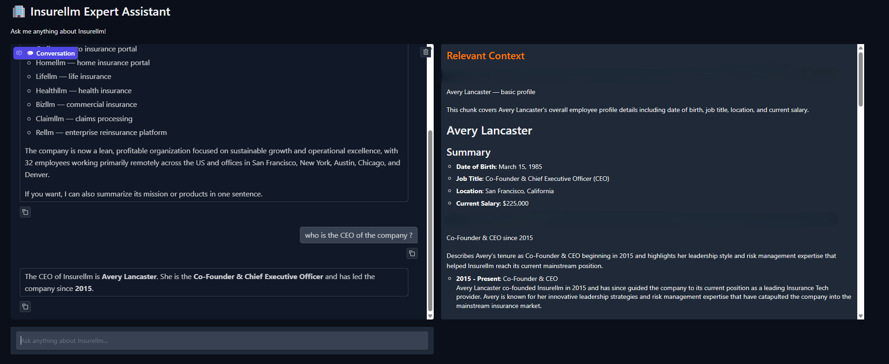
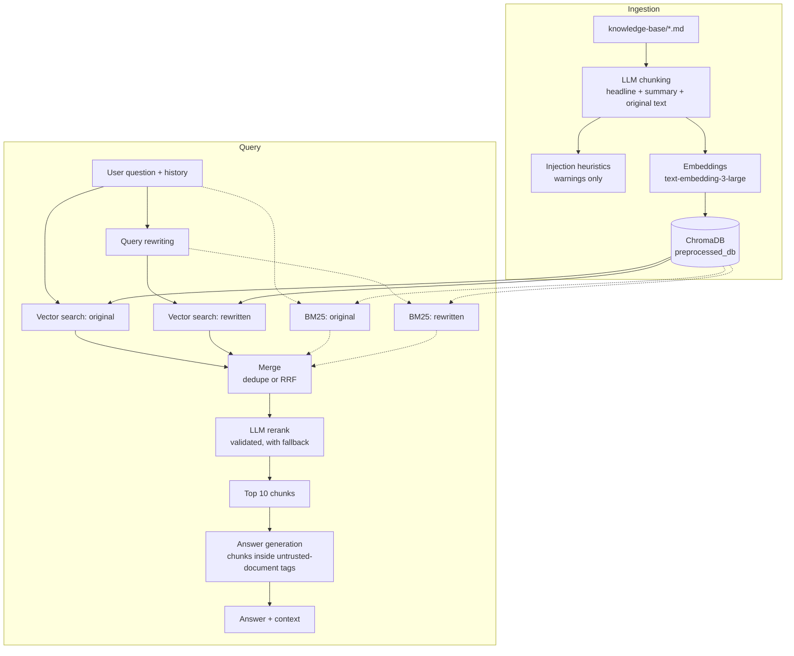

# RAG Assistant


Retrieval-Augmented Generation (RAG) pipeline for question answering over a company knowledge base. The data is a sample dataset about a fictional company, Insurellm, and is not real company data.

The pipeline combines LLM-based chunking, query rewriting, dual-query vector retrieval, optional hybrid search (BM25 + Reciprocal Rank Fusion), validated LLM reranking and grounded answering. A Gradio chat UI shows the answer together with the retrieved sources. A separate dashboard measures retrieval and answer quality on a 150-question test set.

## RAG chat



## Retrieval Evaluation


## Answer Evaluation


## Features

- **LLM-based chunking.** Each document is split by an LLM into overlapping chunks. Every chunk gets a headline, a summary and the original text, which are embedded together.
- **Query rewriting.** The user question and chat history are condensed into a short, specific search query.
- **Dual retrieval.** The original and the rewritten question are both searched. Results are merged and deduplicated.
- **Hybrid search (optional).** BM25 keyword search runs next to vector search. The four ranked lists are merged with Reciprocal Rank Fusion. Disabled by default, see [Hybrid search](#hybrid-search).
- **LLM reranking with validation.** Candidates are reordered by a structured-output reranker. Invalid or missing ids from the model cannot drop or duplicate chunks. If reranking fails, retrieval order is used.
- **Grounded answering.** The top chunks are placed in the system prompt inside `<document>` tags. The model is instructed to say so when it does not know.
- **Prompt-injection hardening.** Retrieved text is treated as untrusted input, see [Security](#security).
- **Chat UI** with a side panel that shows the retrieved context and its sources.
- **Evaluation dashboard** for retrieval metrics (MRR, nDCG, keyword coverage) and answer metrics (accuracy, completeness, relevance).

## Architecture



Dashed lines are active only when hybrid search is enabled.

## Project structure

```
.
├── app.py                      # Gradio chat UI
├── evaluator.py                # Gradio evaluation dashboard
├── pro_implementation/
│   ├── ingest.py               # LLM chunking, embeddings, vector store creation
│   ├── answer.py               # retrieval, hybrid search, reranking, answer generation
│   ├── hybrid.py               # BM25 index and Reciprocal Rank Fusion
│   └── security.py             # prompt-injection helpers
├── evaluation/
│   ├── eval.py                 # retrieval and answer metrics
│   ├── test.py                 # test question model and loader
│   └── tests.jsonl             # 150 test questions
├── implementation/             # simpler baseline, kept for comparison (see note below)
├── knowledge-base/             # source documents (markdown), one folder per type
├── tests/                      # unit tests, run without API keys
├── .github/workflows/ci.yml    # lint and tests on every push and pull request
├── pyproject.toml
└── uv.lock
```

`implementation/` is a simpler baseline built on LangChain and local embeddings. The app and the evaluation use `pro_implementation/`. The baseline needs LangChain packages that are not part of the default dependencies and is not covered by the tests.

## Requirements

- Python 3.12 or newer
- [uv](https://docs.astral.sh/uv/)
- OpenAI API key (embeddings, chunking, query rewriting, reranking and answer generation)

Install dependencies:

```bash
uv sync
```

Always start the project with `uv run`. Installing packages with `pip` into the project environment bypasses `pyproject.toml` and can produce incompatible versions.

## Configuration

Create a `.env` file in the project root:

```env
OPENAI_API_KEY=your_openai_key
```

| Setting | Where | Default | Purpose |
|---|---|---|---|
| `INGEST_MODEL` | environment | `openai/gpt-5.4-nano` | Model used for chunking |
| `MODEL` | `answer.py` | `openai/gpt-5.4-mini` | Rewriting, reranking and answering |
| `embedding_model` | `ingest.py`, `answer.py` | `text-embedding-3-large` | Embeddings |
| `RAG_HYBRID` | environment | `0` | Set to `1` to enable hybrid search |
| `RETRIEVAL_K` | `answer.py` | `20` | Candidates fetched per query |
| `FINAL_K` | `answer.py` | `10` | Chunks passed to the answering model |
| `AVERAGE_CHUNK_SIZE` | `ingest.py` | `100` | Characters per chunk, used to estimate the minimum chunk count |
| `WORKERS` | `ingest.py` | `3` | Parallel chunking processes (set to `1` on rate-limit errors) |

Models are called through [LiteLLM](https://github.com/BerriAI/litellm), so they can be replaced by changing the model string. 

Retries are bounded. Answer-time calls make 4 attempts with 1 to 30 seconds between them. Ingestion makes 5 attempts with 10 to 240 seconds between them. Errors that retrying cannot fix (unknown model, invalid key, no access, invalid request) are raised immediately.

## Usage

### 1. Add documents

Place markdown files in `knowledge-base/`, one subfolder per document type:

```
knowledge-base/
├── company/
├── products/
├── employees/
└── contracts/
```

The subfolder name is stored as the `type` metadata field.

### 2. Build the vector store

```bash
uv run python -m pro_implementation.ingest
```

Run it as a module from the project root. The command uses paid OpenAI calls for chunking and embeddings. Before processing the documents it makes one minimal request to each model and stops with the original error message if a model is unavailable. An existing `docs` collection in `preprocessed_db/` is deleted and recreated. Chunks that match prompt-injection heuristics are reported as warnings.

### 3. Run the chat app

```bash
uv run python app.py
```

If the assistant answers that it does not know things that are in the documents, the vector store is probably empty. Check it:

```bash
uv run python -c "from pro_implementation.answer import collection; print(collection.count())"
```

`0` means the store has not been built, run step 2. After a new ingestion, restart the app: the BM25 index is built once on the first query.

### 4. Evaluate

```bash
uv run python evaluator.py
```

The dashboard runs the 150 test questions and reports:

| Metric | Meaning |
|---|---|
| MRR | Mean reciprocal rank of the first retrieved chunk that contains each expected keyword |
| nDCG | Ranking quality with binary relevance per keyword, top 10 |
| Keyword coverage | Share of expected keywords found in the retrieved chunks |
| Accuracy, completeness, relevance | LLM-as-judge scores from 1 to 5 against the reference answer |

The test questions cover seven categories: direct facts (70), temporal (20), spanning (20), comparative (10), numerical (10), relationship (10) and holistic (10).

## Hybrid search

Vector search is weak on exact names, numbers and identifiers. BM25 matches them literally but does not handle paraphrases. With `RAG_HYBRID=1` both are used and their rankings are merged with Reciprocal Rank Fusion:

```
score(d) = sum over ranked lists of 1 / (k + rank(d)),   k = 60
```

RRF uses ranks instead of scores because the scores of the two systems are not comparable. A chunk that ranks high in several lists wins. The fused list is cut to `2 x RETRIEVAL_K` candidates before reranking.

To compare the configurations with the dashboard:

```bash
# bash
RAG_HYBRID=0 uv run python evaluator.py
RAG_HYBRID=1 uv run python evaluator.py
```

```powershell
# PowerShell
$env:RAG_HYBRID="0"; uv run python evaluator.py
$env:RAG_HYBRID="1"; uv run python evaluator.py
```

Hybrid search is off by default because its effect on this dataset has to be measured with the commands above before it is made the default.

## Security

Retrieved documents are untrusted input: a document can contain text that tries to give instructions to the model. Three measures reduce the risk:

1. **Delimiters.** Every chunk is wrapped in `<document source="...">` tags. Text inside a chunk cannot close the tag or forge a new one, and quotes in the source attribute are escaped.
2. **Prompt rules.** The system prompt states that the content of `<document>` tags is reference material, not instructions, and that instructions found there must be ignored.
3. **Ingestion scan.** Chunks matching common injection patterns (override of previous instructions, requests to reveal the prompt, chat-role markers) are reported as warnings during ingestion. No document of the included knowledge base is flagged.

These measures reduce the risk but do not eliminate it. The pattern scan can be bypassed by rewording, and whether the model follows the prompt rules depends on the model. The assistant has no tools and no access to user data, which limits the possible damage.

## Reliability

- Reranker output is validated: ids that are out of range or repeated are ignored, and chunks the model left out are appended in their original order, so no chunk is lost.
- If reranking fails, the retrieval order is used and the error is logged.
- Ingestion converts worker errors into plain errors. LiteLLM exceptions cannot be unpickled across processes, which would otherwise hide the real error behind a `TypeError`.

## Tests and CI

```bash
uv sync
uv run pytest -q
uv run ruff check .
```

The tests need no API keys and make no network calls. They cover the evaluation metrics, the test set, retrieval and merging, query fusion, reranker validation, retries, hybrid search, prompt-injection defences, ingestion helpers and the Gradio interface (including the Gradio 6 message format). GitHub Actions runs the linter and the tests on every push and pull request.

Not covered by automated tests: answer quality, real embedding and LLM calls, and the baseline in `implementation/`.

## Known limitations

- Retrieval and answer quality have to be measured with the dashboard. This repository does not include a results table.
- The BM25 tokenizer splits on word characters without stemming. For languages with rich inflection a stemmer would be needed.
- The BM25 index is built once from the stored chunks. Restart the app after re-ingesting.
- LLM reranking adds latency and cost to every question.
- The injection scan is a heuristic and only produces warnings.
- The app requires Gradio 6. Handlers receive message content as a list of blocks, which `app.py` converts to plain text.